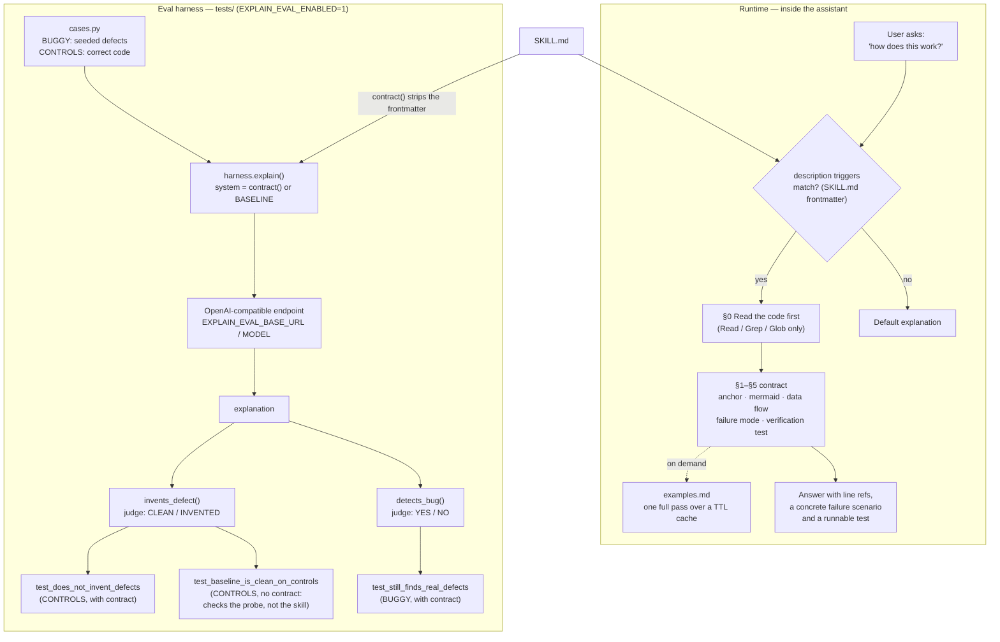

> 🇪🇸 [Versión en español](README.es.md)

# explain-code

An [Agent Skill](https://code.claude.com/docs/en/skills) that forces an AI
assistant to explain code the way a good engineer would: with a mental model, a
diagram of the actual mechanism, exact line references, a concrete failure
scenario, and a test you can run to check that any of it is true.

No dependencies. No scripts. No network calls. It is one Markdown file that
changes what the assistant is allowed to say.

## Why

Ask an assistant "how does this work?" and the default answer restates the syntax
you can already see, then hedges with "you may want to consider potential race
conditions". Every sentence is true and none of it is actionable.

This skill replaces that default with a five-part contract, and — the part that
matters — gives each part a **failure criterion**:

| Part | What it demands | How it fails |
|---|---|---|
| 1. Mental Anchor | A physical analogy, and *why* the pattern exists | An analogy that never declares where it breaks |
| 2. Visual Architecture | A Mermaid diagram of the mechanism | A box per module — a table of contents, not a diagram |
| 3. Data Flow | Input, transformations with `file.ts:L12-L24`, output, side effects | Line numbers nobody opened |
| 4. Failure Modes | A concrete scenario with inputs and the wrong result | "Could have a race condition" — a category, not a finding |
| 5. Verification Vector | A minimal test targeting the failure from part 4 | A happy-path test that passes on broken code |

Section 0 is a hard precondition: **never explain code you have not read**, and
never fabricate a citation. One invented line number costs every other line
number its credibility.

The assistant is also explicitly allowed to *collapse* sections that have no
substance. Padding an empty section is the same failure as a generic summary.

## Install

Claude Code, per project:

```bash
git clone https://github.com/Fedgutcor/explain-code-skill .claude/skills/explain-code
```

Or globally, for every project:

```bash
git clone https://github.com/Fedgutcor/explain-code-skill ~/.claude/skills/explain-code
```

Both leave a `.git/` inside the skill folder (~124 KB). If you would rather keep
it clean, download the two files instead — or clone into `~/projects` and symlink
`~/.claude/skills/explain-code` to it, which is how I run it myself.

Then just ask normally — `cómo funciona esto`, `explain code`, `walk me through
this`. The `description` field carries the triggers, so the assistant loads the
skill on its own. You can also invoke it explicitly with `/explain-code`.

**Other assistants:** paste the body of [`SKILL.md`](SKILL.md) (everything below
the YAML frontmatter) into your system prompt or custom instructions. The
contract does not depend on Claude Code.

## What's here

- [`SKILL.md`](SKILL.md) — the contract itself. ~70 lines.
- [`examples.md`](examples.md) — one complete pass over real code (a TTL cache
  with a stampede bug), next to the generic output the contract forbids. Loaded
  by the assistant on demand, and worth reading yourself: the difference between
  the two is not length, it is whether a reader could act on it.

## How it works

Two mechanisms live here, and they never touch at runtime. The first is the
contract the assistant obeys; the second is the harness that measures whether
obeying it changes the answer. Derived from the code as of this commit: the
nodes name the actual files and functions.



Where it breaks: the harness grades with a model, so a judge that is the same
model as the explainer is a weaker check (`EXPLAIN_JUDGE_MODEL` exists for that
reason), and a failing `test_baseline_is_clean_on_controls` means the control
snippet is guilty, not the contract.

## Does it work?

Measured, including where it lost: [EVAL.md](EVAL.md). Short version — on code
with a real defect a blind judge preferred this contract's explanations 5–0 for
repair work; on *correct* code it lost 2–0 and, in one case, invented a defect
that was not there. That finding changed the contract, and is now frozen as a
regression test in [`tests/`](tests).

## Where it came from

I wrote this for my own work and gave it away in an article on skills that are
worth installing: [Skills seguras para asistentes de
IA](https://ultragresion.com/es/blog/skills-seguras-para-asistentes-de-ia/)
(Spanish · [English](https://ultragresion.com/en/blog/skills-seguras-para-asistentes-de-ia/)).

The repository exists because of a defect in that article. It published the skill
as a block to copy and paste, translated into Spanish — and the translation had
silently dropped the triggers from the `description` field, which is exactly the
mechanism that makes a skill auto-activate. The gift did not work the way the
copy I run does. One source, in one place, is the fix.

Contributions and forks: [CONTRIBUTING.md](CONTRIBUTING.md).

## License

MIT. Use it, fork it, change the contract to fit how your team explains things.
