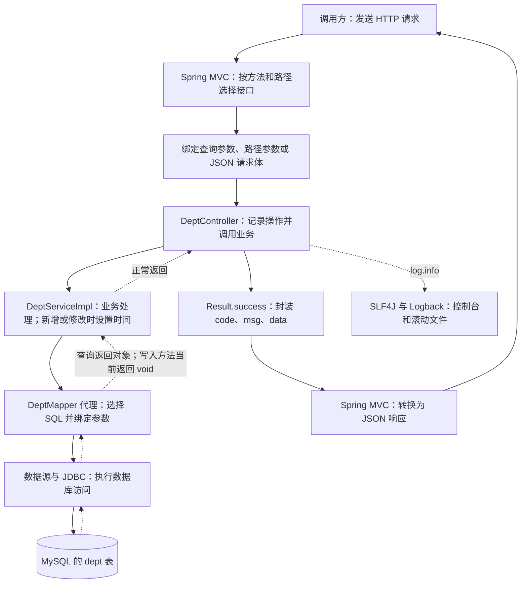
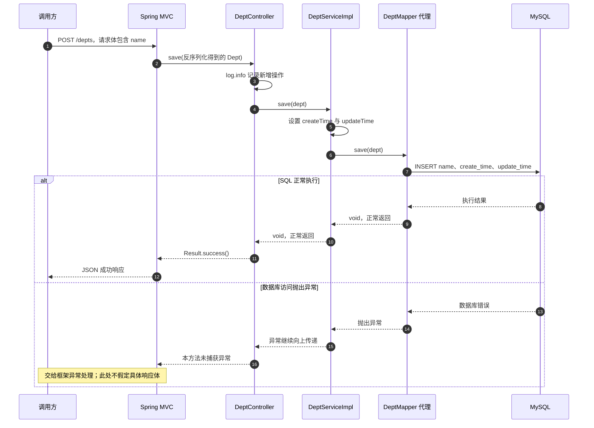
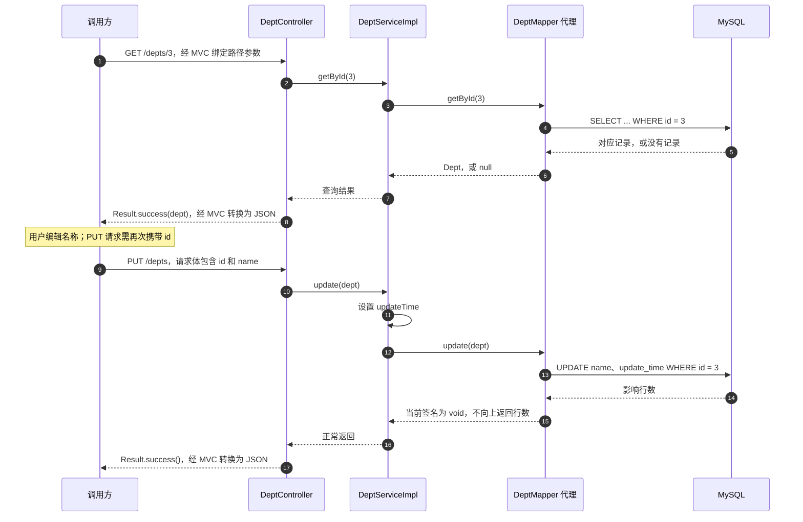

# 2026-11-18 学习复盘：从部门管理 CRUD 理解 Java Web 请求链路

可以把这套后端想成一个办事窗口：Controller 接收申请，Service 决定怎样办理，Mapper 负责读写档案，数据库保存档案。这样分工，是为了让“接收 HTTP 请求”“处理业务规则”“执行 SQL”各有自己的位置。类比到这里就够了：这些层实际上是同一个 Java 应用里的对象与方法调用，不是几个独立运行的服务。

**阅读日期：2026-11-18（Asia/Shanghai）。复盘依据：本项目当前源码，按已安装的 `explain-code` 技能流程整理。** 文中“涉及的知识”表示代码提供了学习材料，是否掌握可用最后的自测题检查。

> 范围说明：项目根目录及后端目录均没有可用的 Git 历史，不能还原今天逐行增加或修改了什么。本文将今天修改过的后端业务源码、配置作为主要范围；`Dept.java`、`Result.java` 的修改日期为 11 月 15 日，作为复用基础阅读。早些时候的“项目结构与运行笔记”只记载了部门列表查询，现在源码还包含删除、新增、单条查询与修改；这只能辅助判断学习进展，不能代替代码差异。本文为静态源码分析，没有启动应用、连接数据库或实测接口。

## 1. 今日源码呈现的功能

今天这份代码形成了一条完整的部门管理链路：调用方发请求，后端绑定参数，经过业务层执行 SQL，最后返回统一结果。

| 功能 | 请求示例 | 处理入口 | 实际执行的事情 |
| --- | --- | --- | --- |
| 查询部门列表 | `GET /depts` | [DeptController.list，第 23 行](D:/agent_project/javaweb/web-project-AI/tlias-web-management/src/main/java/com/itheima/controller/DeptController.java:23) | 查询全部部门，按 `update_time` 倒序排列，返回部门列表 |
| 删除部门 | `DELETE /depts?id=3` | [DeptController.delete，第 34 行](D:/agent_project/javaweb/web-project-AI/tlias-web-management/src/main/java/com/itheima/controller/DeptController.java:34) | 从查询参数接收 `id`，执行带 `where id = ...` 的删除 |
| 新增部门 | `POST /depts`，请求体 `{"name":"教研部"}` | [DeptController.save，第 46 行](D:/agent_project/javaweb/web-project-AI/tlias-web-management/src/main/java/com/itheima/controller/DeptController.java:46) | 接收部门对象，补充创建时间和更新时间，插入数据库 |
| 查询单个部门，供编辑回显 | `GET /depts/3` | [DeptController.getById，第 58 行](D:/agent_project/javaweb/web-project-AI/tlias-web-management/src/main/java/com/itheima/controller/DeptController.java:58) | 从路径中接收 `id`，查询对应部门并返回 |
| 修改部门 | `PUT /depts`，请求体 `{"id":3,"name":"教学研究部"}` | [DeptController.update，第 67 行](D:/agent_project/javaweb/web-project-AI/tlias-web-management/src/main/java/com/itheima/controller/DeptController.java:67) | 按 `id` 更新名称和更新时间，保留数据库中的创建时间 |

此外，Controller 使用 `@Slf4j`、`log.info(...)` 记录操作，`logback.xml` 配置了控制台输出和滚动文件输出。数据库连接、端口和 MyBatis 映射规则集中在配置文件中。

**当前能力的边界：** 源码没有分页、部门名称校验、全局异常处理或对数据库影响行数的判断。`Result.error(...)` 已定义，但这些部门接口没有调用它。这里描述实现范围，不把尚未实现的功能写成已经完成。

## 2. 知识点、对应代码及设计原因

### 2.1 同一个 URL，可以通过 HTTP 方法表达不同操作

`/depts` 不只是一个“查部门”的地址。这里 GET 表示查询，POST 表示新增，PUT 表示修改，DELETE 表示删除；`/depts/{id}` 则用于查询指定部门。Spring MVC 根据路径和请求方法共同选择处理函数，不能只看 URL 判断会执行哪段代码。

代码依据是上面的五个映射注解；这些注解是 `@RequestMapping` 的 HTTP 方法专用形式，见 [Spring MVC 请求映射说明](https://docs.spring.io/spring-framework/reference/web/webmvc/mvc-controller/ann-requestmapping.html)。

### 2.2 参数从哪里来，决定如何接收

| 数据所在位置 | 本项目写法 | 实际例子 | 为什么这样写 |
| --- | --- | --- | --- |
| URL 查询字符串 | `delete(Integer id)`，当前省略了 `@RequestParam` | `/depts?id=3` | 适合这里单个简单参数的接收；框架把文本形式的 `3` 转成 `Integer` |
| URL 路径 | `getById(@PathVariable Integer id)` | `/depts/3` | 明确从 `{id}` 所在的路径位置取值 |
| JSON 请求体 | `save(@RequestBody Dept dept)`、`update(@RequestBody Dept dept)` | `{"id":3,"name":"教学研究部"}` | 通过消息转换器将 JSON 反序列化成 Java 对象，便于后续传给业务层 |

对应源码：[查询参数，第 35 行](D:/agent_project/javaweb/web-project-AI/tlias-web-management/src/main/java/com/itheima/controller/DeptController.java:35)、[路径参数，第 59 行](D:/agent_project/javaweb/web-project-AI/tlias-web-management/src/main/java/com/itheima/controller/DeptController.java:59)、[JSON 请求体，第 47 行](D:/agent_project/javaweb/web-project-AI/tlias-web-management/src/main/java/com/itheima/controller/DeptController.java:47)。

省略 `@RequestParam` 适用于这里的简单类型，不能推广成“所有参数只要名字相同，都不需要注解”。另外，省略参数名时，编译产物需保留框架可获取的 Java 参数名。需要明确名称或设置必填规则时，可以写成 `@RequestParam("id")`、`@PathVariable("id")`；这属于后续改进示例，本次未修改源码。显式添加 `@RequestParam` 后，参数默认必填；需要保持可选时应另设 `required=false`，不能把加注解当成完全没有行为差异的替换。

`@RequestBody` 的作用是读取并转换请求体，不会自动把对象保存进数据库。保存还需要调用 Service 和 Mapper。使用 JSON 请求体时，应发送 `Content-Type: application/json`。原理见 [Spring 的查询参数绑定](https://docs.spring.io/spring-framework/reference/web/webmvc/mvc-controller/ann-methods/requestparam.html)及 [请求体转换说明](https://docs.spring.io/spring-framework/reference/web/webmvc/mvc-controller/ann-methods/requestbody.html)。

### 2.3 三层架构与依赖注入：把容易变化的职责分开

| 层 | 本项目中的职责 | 代码依据 | 设计原因 |
| --- | --- | --- | --- |
| Controller | 接收参数、记录请求操作、调用业务、封装响应 | [DeptController，第 13 行](D:/agent_project/javaweb/web-project-AI/tlias-web-management/src/main/java/com/itheima/controller/DeptController.java:13) | HTTP 接口的变化集中在边界处 |
| Service | 新增时补齐时间，修改时刷新更新时间；其余方法转交 Mapper | [DeptServiceImpl，第 32 行](D:/agent_project/javaweb/web-project-AI/tlias-web-management/src/main/java/com/itheima/service/impl/DeptServiceImpl.java:32) | 业务规则不必分散到多个 Controller 或 SQL 调用处 |
| Mapper | 定义 SQL、绑定参数、将查询结果映射为对象 | [DeptMapper，第 8 行](D:/agent_project/javaweb/web-project-AI/tlias-web-management/src/main/java/com/itheima/mapper/DeptMapper.java:8) | 数据库访问有清晰的入口 |

Controller 的字段类型是 `DeptService` 接口，`DeptServiceImpl` 实现该接口，并由 `@Service` 标记。`@Autowired` 注入协作对象；Mapper 接口的实现由 MyBatis 代理提供。业务代码没有自己 `new DeptServiceImpl()` 或编写 Mapper 实现类。

依据：[Controller 注入，第 18 行](D:/agent_project/javaweb/web-project-AI/tlias-web-management/src/main/java/com/itheima/controller/DeptController.java:18)、[Service 接口，第 8 行](D:/agent_project/javaweb/web-project-AI/tlias-web-management/src/main/java/com/itheima/service/DeptService.java:8)、[Service 实现及注入，第 13 行](D:/agent_project/javaweb/web-project-AI/tlias-web-management/src/main/java/com/itheima/service/impl/DeptServiceImpl.java:13)。

### 2.4 MyBatis：SQL 列名与 Java 属性名是两套名字

数据库列使用 `create_time`、`update_time`，Java 对象使用 `createTime`、`updateTime`。项目启用了下划线转驼峰，查询结果才能按这个规则自动映射到对象属性。

依据：[Dept 的属性，第 13 行](D:/agent_project/javaweb/web-project-AI/tlias-web-management/src/main/java/com/itheima/pojo/Dept.java:13)、[映射配置，第 16 行](D:/agent_project/javaweb/web-project-AI/tlias-web-management/src/main/resources/application.yaml:16)、[查询 SQL，第 14 行](D:/agent_project/javaweb/web-project-AI/tlias-web-management/src/main/java/com/itheima/mapper/DeptMapper.java:14)。这一规则针对结果映射，不是说配置之后 SQL 可以随意使用 Java 属性名代替数据库列名，见 [MyBatis 自动映射说明](https://mybatis.org/mybatis-3/sqlmap-xml.html#Auto-mapping)。

### 2.5 `#{}` 绑定值，Service 管理业务时间

Mapper 中的 `#{name}`、`#{createTime}` 从传入的 `Dept` 对象取得属性值，再作为 SQL 参数绑定。它们不是把参数当 SQL 片段直接拼进语句。值参数使用这种方式，更容易正确处理引号等字符；不要随意替换成 `${}` 字符串替换。依据：[新增 SQL，第 26 行](D:/agent_project/javaweb/web-project-AI/tlias-web-management/src/main/java/com/itheima/mapper/DeptMapper.java:26)，原理见 [MyBatis 参数说明](https://mybatis.org/mybatis-3/sqlmap-xml.html#Parameters)。

创建时间、更新时间由 Service 补充，调用方新增时只需提交名称；更新时只刷新更新时间，记录原来什么时候创建的信息仍保留在数据库中。依据：[新增补齐时间，第 34 行](D:/agent_project/javaweb/web-project-AI/tlias-web-management/src/main/java/com/itheima/service/impl/DeptServiceImpl.java:34)、[更新补齐时间，第 48 行](D:/agent_project/javaweb/web-project-AI/tlias-web-management/src/main/java/com/itheima/service/impl/DeptServiceImpl.java:48)。

### 2.6 统一响应与日志：让调用方和开发者各自得到需要的信息

`Result` 把返回对象统一为 `code`、`msg`、`data`。列表查询把 `List<Dept>` 放进 `data`，单条查询放入一个 `Dept`，新增、修改和删除调用不带数据的 `success()`。业务码 `1` 与 HTTP 状态码是不同层次的概念。

依据：[Result 字段及工厂方法，第 13 行](D:/agent_project/javaweb/web-project-AI/tlias-web-management/src/main/java/com/itheima/pojo/Result.java:13)。`Dept` 和 `Result` 使用 Lombok 注解减少 getter、setter 等重复代码；这两份类是前几天已经存在、今天继续使用的基础。

Controller 的 `log.info("根据ID删除部门：{}", id)` 使用占位符记录参数。Logback 配置控制日志格式、级别与输出位置。当前文件配置为按日期和大小滚动，达到约 `10MB` 时触发大小滚动，`MaxHistory=30` 表示保留 30 个历史时间周期；日期格式是按天的，不能把它理解成最多只有 30 个日志文件。规则见 [Logback 滚动文件说明](https://logback.qos.ch/manual/appenders-rolling.html)。

依据：[日志调用，第 37 行](D:/agent_project/javaweb/web-project-AI/tlias-web-management/src/main/java/com/itheima/controller/DeptController.java:37)、[Logback 滚动配置，第 12 行](D:/agent_project/javaweb/web-project-AI/tlias-web-management/src/main/resources/logback.xml:12)。MyBatis 当前使用的是 [StdOutImpl，第 14 行](D:/agent_project/javaweb/web-project-AI/tlias-web-management/src/main/resources/application.yaml:14)，不能据此断言 SQL 日志也会进入 Logback 的文件输出。

## 3. 模块框图与核心请求时序图

以下图根据业务源码推导。Spring MVC 参数转换、MyBatis 代理及 JDBC 部分按框架机制表示，没有逐行跟踪框架内部源码或采集运行时调用轨迹。数据库表结构未提供，本文不推断字段长度、唯一约束或自增配置。

### 3.1 模块框图：一次请求经过哪些处理



实体 `Dept` 贯穿参数接收、业务处理、SQL 参数绑定与结果映射；它是数据载体，不是额外一层服务。图中的虚线表示返回或日志支路。该图展示正常业务链路，SQL 抛异常时不会继续走到 Controller 的 `Result.success()`。

### 3.2 新增部门：JSON 怎样成为数据库中的一条记录



### 3.3 修改部门：先回显，再提交，是两次独立请求



上图假设 SQL 均正常执行。GET 与 PUT 之间不会自动保存“刚才查询的是哪个 id”，所以 PUT 的 JSON 仍要带 `id`。当前代码在查询无记录时直接包装 `null`；更新无匹配记录时，也没有根据影响行数作分支判断。

## 4. 关键代码讲解与易错点

### 4.1 新增部门：`@RequestBody` 完成转换，Service 完成规则补齐

下面是 [DeptController.save，第 46 行](D:/agent_project/javaweb/web-project-AI/tlias-web-management/src/main/java/com/itheima/controller/DeptController.java:46) 中的关键语句，省略原有注释：

```java
@PostMapping("/depts")
public Result save(@RequestBody Dept dept){
    log.info("新增部门, dept={}",dept);
    deptService.save(dept);
    return Result.success();
}
```

输入示例为 `{"name":"教研部"}`。绑定得到的对象最初只有 `name` 有值；下面的 Service 会修改同一个对象的时间属性，再把它交给 Mapper。注意，Controller 中的日志在设置时间之前打印，所以该条日志里时间属性可能仍为 `null`，不等于入库时也没有时间。

下面是 [DeptServiceImpl.save，第 32 行](D:/agent_project/javaweb/web-project-AI/tlias-web-management/src/main/java/com/itheima/service/impl/DeptServiceImpl.java:32) 的关键语句，省略原有注释：

```java
public void save(Dept dept) {
    dept.setCreateTime(LocalDateTime.now());
    dept.setUpdateTime(LocalDateTime.now());
    deptMapper.save(dept);
}
```

这两次 `now()` 是两次取时，时间不保证完全相等。若业务要求新增时两个时间严格一致，可以先取一次 `now` 再赋两次值；这是可选改进，不是现有功能发生错误的证据。

Mapper 最终执行 [第 26 行的 SQL](D:/agent_project/javaweb/web-project-AI/tlias-web-management/src/main/java/com/itheima/mapper/DeptMapper.java:26)：

```java
@Insert("insert into dept(name,create_time,update_time) values (#{name},#{createTime},#{updateTime})")
void save(Dept dept);
```

左侧是数据库列，右侧是 Java 属性取值。SQL 没有插入 `id`，注释表达了由数据库自增生成的意图，但仓库没有提供建表语句，所以还要以真实表结构为准。此外，这里没有生成键回填配置，不能把“数据库生成了 id”和“Java 对象一定获得了新 id”当成同一件事。当前接口也没有返回新增后的部门对象。生成键机制见 [MyBatis 的 useGeneratedKeys 说明](https://mybatis.org/mybatis-3/sqlmap-xml.html#insert_update_and_delete)。

### 4.2 修改部门：定位靠 id，修改字段由 SQL 决定

输入 `{"id":3,"name":"教学研究部"}` 后，Service 刷新 `updateTime`，执行的 SQL 为：

```java
@Update("update dept set name = #{name},update_time = #{updateTime} where id = #{id}")
void update(Dept dept);
```

依据：[DeptMapper.update，第 38 行](D:/agent_project/javaweb/web-project-AI/tlias-web-management/src/main/java/com/itheima/mapper/DeptMapper.java:38)。`where` 决定修改哪条记录，`set` 决定修改哪些列。`create_time` 没有出现在 `set` 中，因此数据库里原来的创建时间不会被这条语句改掉。这也说明：接收了一个对象，不等于一定要把对象的每个属性都覆盖进数据库。

### 4.3 能从源码确认的记录错误：更新操作被写成“新增”

[DeptController.update，第 70 行](D:/agent_project/javaweb/web-project-AI/tlias-web-management/src/main/java/com/itheima/controller/DeptController.java:70) 的实际日志是：

```java
log.info("新增部门, dept={}",dept);
```

具体场景：执行一次 `PUT /depts` 修改名称，数据库走的是 UPDATE，但这条操作日志会显示“新增部门”。按“新增”或“修改”检索日志时容易误判发生了什么。修正方向是把消息改为“修改部门”；本次只做学习复盘，没有替你修改业务代码。

**最小核验场景（未执行）：** 在学习用数据中准备一条已存在的部门，发出一次合法 PUT 请求；预期数据库只有该记录名称及更新时间发生变化，但当前 Controller 对应日志文字仍是“新增部门”。核验的是操作与日志是否一致，不是要求数据库再新增一条记录。

### 4.4 容易混淆的实现边界：没有异常，不代表命中了记录

当前删除、修改的 Mapper 都返回 `void`，Service 没有获取影响行数，Controller 在正常返回后调用 `Result.success()`。因此，如果目标 `id` 在执行 SQL 时不存在，语句正常执行但影响 0 行，这条调用链仍会返回业务码 `1`。单条查询没有结果时，则会把 `null` 传给 `Result.success(Object)`，业务码同样是 `1`。

依据：[删除 Mapper，第 21 行](D:/agent_project/javaweb/web-project-AI/tlias-web-management/src/main/java/com/itheima/mapper/DeptMapper.java:21)、[更新 Mapper，第 39 行](D:/agent_project/javaweb/web-project-AI/tlias-web-management/src/main/java/com/itheima/mapper/DeptMapper.java:39)、[Controller 返回结果，第 62 行](D:/agent_project/javaweb/web-project-AI/tlias-web-management/src/main/java/com/itheima/controller/DeptController.java:62)、[Result.success(Object)，第 24 行](D:/agent_project/javaweb/web-project-AI/tlias-web-management/src/main/java/com/itheima/pojo/Result.java:24)。

这是当前接口的语义边界，不能在没有业务约定时把所有“影响 0 行”都判为错误，例如重复删除也可以被设计成成功。如果业务要求“指定部门必须存在并被修改”，可以让 Mapper 返回 `int`、由 Service 判断行数，再决定响应；MyBatis 支持返回影响行数，见 [MyBatis Java API](https://mybatis.org/mybatis-3/java-api.html)。

**最小推演（未执行）：** 假定 id=3 已确认不存在，且 SQL 正常执行；提交 `PUT /depts`、请求体 `{"id":3,"name":"教学研究部"}`。沿代码走一遍：Service 设置时间 → SQL 匹配 0 行 → Mapper 正常返回 → Controller 创建 `code=1`、`msg="success"`、`data=null` 的 Result。这个推演没有假设任何异常拦截器，也不等于已经做过接口测试。

### 4.5 把四种“占位”分清楚

| 写法 | 所在位置 | 在这里的作用 |
| --- | --- | --- |
| `/depts/{id}` | HTTP 路由 | `{id}` 是路径变量 |
| `@RequestBody Dept dept` | Controller 形参 | 读取 JSON 请求体并转换为对象 |
| `#{id}` | MyBatis SQL | 绑定 SQL 值参数 |
| `log.info("id={}", id)` | 日志调用 | `{}` 是日志消息的参数占位符 |

它们出现的位置和处理者不同，不能互换。尤其不要把“JSON 转对象”“Java 对象转 SQL 参数”“查询结果转对象”理解为一次自动完成的操作。

## 5. 三道自测题

先不看答案，用自己的话说明请求从哪里进入、经过哪些方法，以及会改变什么数据。

### 第 1 题：三种参数，你能选对接收方式吗？

分别说明 `DELETE /depts?id=3`、`GET /depts/3`、`POST /depts` 配合 `{"name":"教研部"}`，对应哪个 Controller 方法、参数来自哪里，以及由什么机制转换成 Java 参数。为什么不能把 JSON 请求体直接当成这里的查询参数来接收？

### 第 2 题：新增与修改，时间字段和 id 分别怎样处理？

新增只发送 `name` 时，谁设置 `createTime`、`updateTime`？两者保证完全相等吗？修改为什么不会覆盖数据库的创建时间？SQL 不插入 `id`，能否据此断言新增后 Java 对象的 `id` 一定有值？

### 第 3 题：为什么“显示成功”仍可能没有修改任何记录？

假定一个部门 id 已不存在，对它发出合法 PUT 请求，且 SQL 正常执行。沿 Controller → Service → Mapper 说明目前会发生什么。如果业务要求“必须更新到一个部门才算成功”，你会在哪几层增加哪些判断？

<details>
<summary>完成后展开：答案要点与检查标准</summary>

**第 1 题：** `delete(Integer id)` 从查询参数取值；`getById(@PathVariable Integer id)` 从路径取值；`save(@RequestBody Dept dept)` 经消息转换器把请求体 JSON 转为对象。能够说出“参数所在位置”和“接收方式”的对应关系，比只背注解名称更重要。

**第 2 题：** Service 在新增时设置两个时间，分别调用 `now()`，不保证完全相等。更新只设置 `updateTime`，SQL 只更新 `name` 和 `update_time`，没有改 `create_time`。数据库是否自增需要查表结构；Java 对象是否回填 id 还要看生成键配置，这里未配置。

**第 3 题：** 更新 SQL 匹配 0 行也可能正常结束；Mapper 返回 `void`，上层没有根据影响行数作分支，Controller 仍构造成功结果。若业务需要区分，应让 Mapper 返回行数、Service 根据业务约定判断、Controller 或统一异常处理将结果转换成约定的响应。单纯在修改前查一次“是否存在”，不能替代对最终更新结果的判断，因为两次操作之间数据可能变化。

</details>

## 6. 阅读证据与本次核对范围

| 主体 | 读取的源码或配置 | 本次用途 |
| --- | --- | --- |
| 应用入口与依赖 | [启动类，第 6 行](D:/agent_project/javaweb/web-project-AI/tlias-web-management/src/main/java/com/itheima/TliasWebManagementApplication.java:6)、[pom.xml，第 32 行](D:/agent_project/javaweb/web-project-AI/tlias-web-management/pom.xml:32) | 核对 Spring Boot、Web MVC、MyBatis、MySQL 与 Lombok 的使用 |
| HTTP 接口 | [DeptController，第 12 行](D:/agent_project/javaweb/web-project-AI/tlias-web-management/src/main/java/com/itheima/controller/DeptController.java:12) | 核对五个请求入口、参数和响应 |
| 业务处理 | [DeptService，第 8 行](D:/agent_project/javaweb/web-project-AI/tlias-web-management/src/main/java/com/itheima/service/DeptService.java:8)、[DeptServiceImpl，第 13 行](D:/agent_project/javaweb/web-project-AI/tlias-web-management/src/main/java/com/itheima/service/impl/DeptServiceImpl.java:13) | 核对接口实现与时间补齐 |
| 数据访问 | [DeptMapper，第 8 行](D:/agent_project/javaweb/web-project-AI/tlias-web-management/src/main/java/com/itheima/mapper/DeptMapper.java:8) | 核对 SQL、属性取值和返回类型 |
| 复用基础 | [Dept，第 9 行](D:/agent_project/javaweb/web-project-AI/tlias-web-management/src/main/java/com/itheima/pojo/Dept.java:9)、[Result，第 10 行](D:/agent_project/javaweb/web-project-AI/tlias-web-management/src/main/java/com/itheima/pojo/Result.java:10) | 核对实体字段与结果构造 |
| 配置 | [application.yaml，第 12 行](D:/agent_project/javaweb/web-project-AI/tlias-web-management/src/main/resources/application.yaml:12)、[logback.xml，第 12 行](D:/agent_project/javaweb/web-project-AI/tlias-web-management/src/main/resources/logback.xml:12) | 核对 MyBatis 映射、SQL 输出与业务日志输出；未复制数据库凭据 |
| 已有测试 | [应用测试，第 6 行](D:/agent_project/javaweb/web-project-AI/tlias-web-management/src/test/java/com/itheima/TliasWebManagementApplicationTests.java:6) | 当前只有 `contextLoads()`，不能作为五个接口已经通过测试的证据 |

本次只安装技能并生成笔记，核对了源码位置、图中调用关系和请求示例。前端目录是已有打包资源，不作为“今天编写的前端源码”分析。本文中的请求示例、数据库场景均未执行，最终接口行为仍需在学习用数据库中验证。

技能入口：[本项目 explain-code/SKILL.md](D:/agent_project/javaweb/web-project-AI/.agents/skills/explain-code/SKILL.md)。来源：[Fedgutcor/explain-code-skill](https://github.com/Fedgutcor/explain-code-skill)，MIT 许可，安装日期为 2026-11-18。后续在本项目可以用 `$explain-code` 指定该技能；做每日复盘时仍应说明当天的文件或变更范围。
