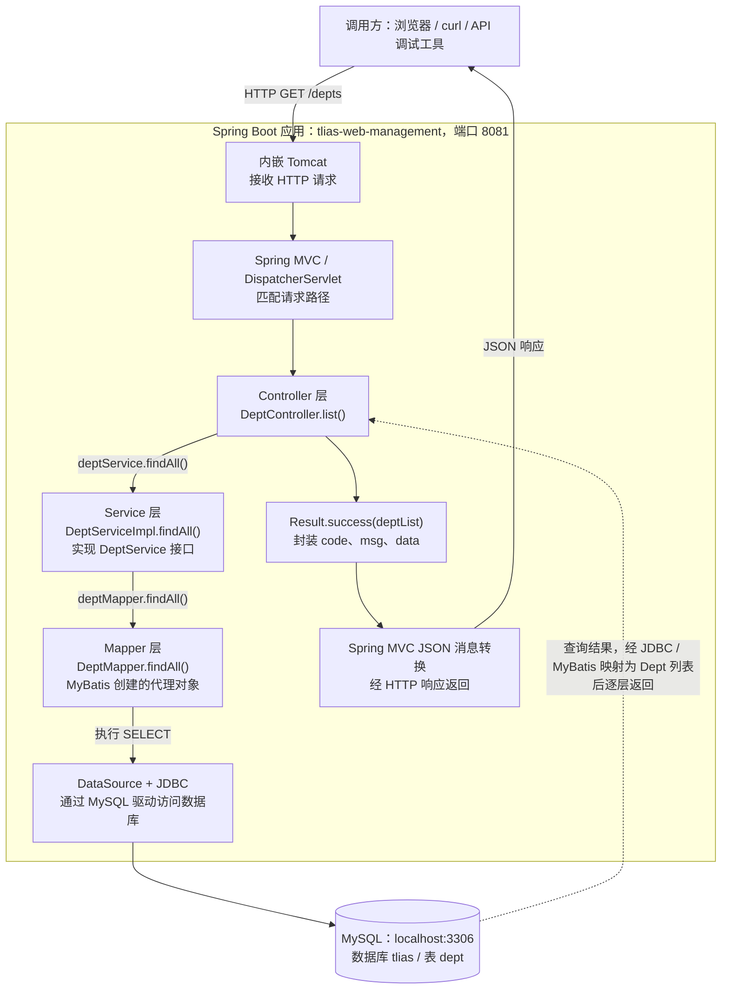
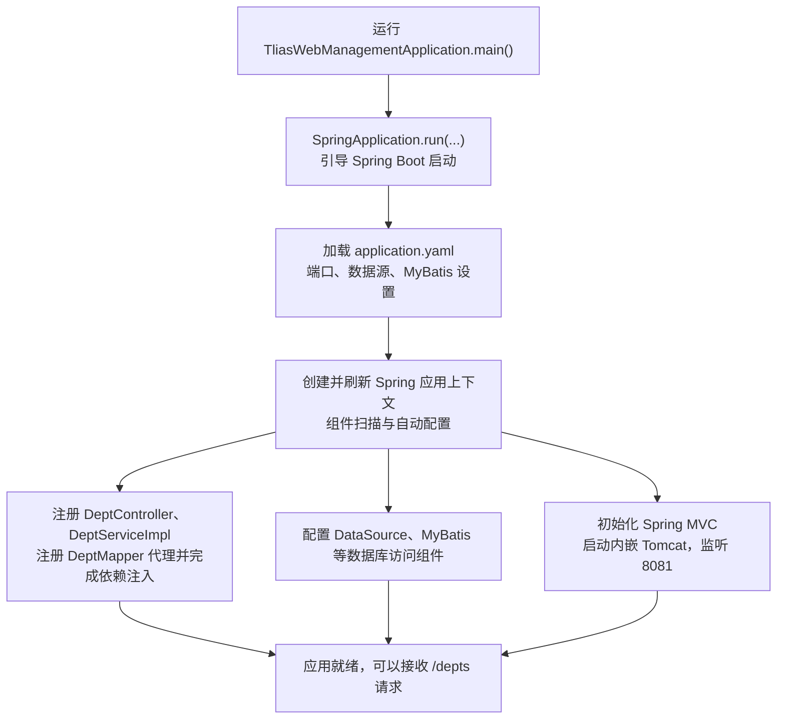
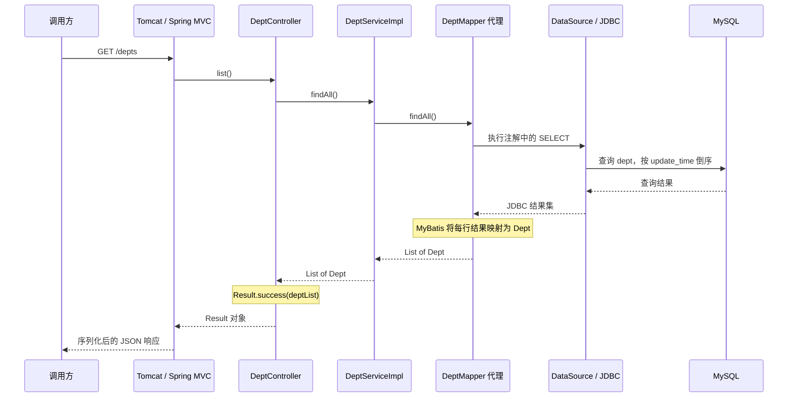

# 项目结构与运行笔记

阅读日期：2026-11-18  
项目：`tlias-web-management`  
阅读依据：当前工作区中的全部业务源码、配置、构建文件及测试源码。

> 本文描述当前代码已经实现的功能。运行框图根据源码与依赖配置绘制，未启动应用、连接数据库或实测接口。文中的响应数据为示例。

## 1. 项目概况

这是一个采用 **Spring Boot + Spring MVC + MyBatis + MySQL** 的 Java Web 后端项目，使用 Maven 构建，业务代码采用 Controller、Service、Mapper 三层结构。

当前已经实现的业务是：**查询全部部门，按更新时间倒序返回，并包装成统一的 JSON 结果。**

| 项目项 | 当前内容 | 依据 |
| --- | --- | --- |
| Maven 坐标 | `com.itheima:tlias-web-management:0.0.1-SNAPSHOT` | `pom.xml` |
| Java 版本 | 21 | `pom.xml` 中的 `java.version` |
| Spring Boot 版本 | 4.0.9 | `pom.xml` 的父工程版本 |
| Web 组件 | Spring MVC、内嵌 Tomcat、JSON 消息转换 | `spring-boot-starter-webmvc` 及其依赖 |
| MyBatis Starter 版本 | 4.0.1 | `pom.xml` |
| 数据库驱动 | MySQL Connector/J，运行时依赖 | `pom.xml` |
| 辅助工具 | Lombok | `pom.xml` 与实体类注解 |
| 应用名称 | `tlias-web-management` | `application.yaml` |
| HTTP 端口 | `8081` | `application.yaml` |
| 数据库连接 | `jdbc:mysql://localhost:3306/tlias` | `application.yaml` |
| 已有业务入口 | `/depts` | `DeptController` |

这里的版本是项目声明值，不代表对其他版本的兼容性结论。当前没有前端源码；`static`、`templates` 目录均为空。

## 2. 项目目录结构

```text
web-project-AI/
├─ 项目结构与运行笔记.md                 # 本文
├─ web-project-AI.iml                   # IDEA 工程文件
├─ .idea/                              # IDEA 配置，不属于业务执行链路
└─ tlias-web-management/                # 实际 Maven / Spring Boot 工程
   ├─ pom.xml                          # 依赖、Java 版本、构建插件
   ├─ mvnw                             # Unix 类系统的 Maven Wrapper 脚本
   ├─ mvnw.cmd                         # Windows 的 Maven Wrapper 脚本
   ├─ .mvn/wrapper/
   │  └─ maven-wrapper.properties       # Wrapper 与 Maven 分发配置
   ├─ HELP.md                          # 工程生成时的参考文档
   ├─ src/
   │  ├─ main/
   │  │  ├─ java/com/itheima/
   │  │  │  ├─ TliasWebManagementApplication.java  # 启动入口
   │  │  │  ├─ controller/
   │  │  │  │  └─ DeptController.java             # 接收部门查询请求
   │  │  │  ├─ service/
   │  │  │  │  ├─ DeptService.java                # 部门业务接口
   │  │  │  │  └─ impl/
   │  │  │  │     └─ DeptServiceImpl.java         # 部门业务实现
   │  │  │  ├─ mapper/
   │  │  │  │  └─ DeptMapper.java                 # SQL 与结果映射入口
   │  │  │  └─ pojo/
   │  │  │     ├─ Dept.java                       # 部门数据对象
   │  │  │     └─ Result.java                     # 统一响应对象
   │  │  └─ resources/
   │  │     ├─ application.yaml        # 数据源、MyBatis、端口配置
   │  │     ├─ static/                 # 空目录
   │  │     └─ templates/              # 空目录
   │  └─ test/java/com/itheima/
   │     └─ TliasWebManagementApplicationTests.java
   └─ target/                          # 已存在的编译输出，不作为源码依据
```

下面提到的源码路径均以 `tlias-web-management/` 为基准。

## 3. 项目运行框图

### 3.1 整体结构与请求流向



图中的虚线概括数据返回过程，数据库结果实际经过 JDBC、Mapper、Service 后才到达 Controller，完整过程见第 3.3 节。

如果阅读工具不支持 Mermaid，可以按下面的文本框图理解：

```text
请求：调用方 → Tomcat → Spring MVC → DeptController
     → DeptServiceImpl → DeptMapper 代理 → DataSource / JDBC → MySQL

返回：MySQL → JDBC 查询结果 → MyBatis 映射为 List<Dept>
     → DeptServiceImpl → DeptController → Result.success(...)
     → JSON 消息转换 → 调用方
```

### 3.2 应用启动流程



这是启动阶段的逻辑概括，不表示内部组件严格按图中排列顺序逐一初始化。

入口类位于 `com.itheima` 包，`@SpringBootApplication` 默认扫描其所在包及子包，因此当前的 Controller、Service 等都在扫描范围内。`@Mapper` 接口则由 MyBatis 的集成机制识别并注册代理。

数据源组件完成配置不代表业务 SQL 已经执行。连接可能在使用时获取，应用能够启动也不能单独证明 `dept` 表存在或查询成功。

### 3.3 一次部门查询的时序图



该时序图描述正常返回路径；数据库异常等情况会中断后续正常返回步骤。

## 4. 逐层阅读源码

### 4.1 启动入口

文件：`src/main/java/com/itheima/TliasWebManagementApplication.java`

```java
@SpringBootApplication
public class TliasWebManagementApplication {
    public static void main(String[] args) {
        SpringApplication.run(TliasWebManagementApplication.class, args);
    }
}
```

这段代码负责引导应用启动。业务查询由启动后注册的 Controller、Service、Mapper 协作完成。

### 4.2 Controller：接收请求和封装响应

文件：`src/main/java/com/itheima/controller/DeptController.java`

- `@RestController`：将类注册为控制器，方法返回值交给消息转换器写入响应体。
- `@Autowired private DeptService deptService`：注入部门业务服务，当前唯一实现是 `DeptServiceImpl`。
- `@RequestMapping("/depts")`：将 `/depts` 路径映射到 `list()`，代码未限定 HTTP 方法；本文用 GET 演示调用。
- `list()`：打印查询提示，调用 `deptService.findAll()`，再返回 `Result.success(deptList)`。

Controller 没有直接编写 SQL，也没有分页、筛选或请求参数。

### 4.3 Service：定义业务能力并组织调用

文件：`src/main/java/com/itheima/service/DeptService.java`  
实现：`src/main/java/com/itheima/service/impl/DeptServiceImpl.java`

接口定义 `List<Dept> findAll()`；实现类使用 `@Service` 注册为 Spring Bean，并通过 `@Autowired` 注入 `DeptMapper`。

当前业务实现只有一条转调语句：

```java
return deptMapper.findAll();
```

因此目前 Service 没有额外的数据加工或业务判断。以后需要组合多个查询或增加业务规则时，可以在这一层扩展。

### 4.4 Mapper：执行 SQL 和映射数据

文件：`src/main/java/com/itheima/mapper/DeptMapper.java`

`DeptMapper` 是带有 `@Mapper` 的接口。项目没有手写它的实现类，运行时由 MyBatis 提供代理。SQL 直接放在 `@Select` 注解中，当前没有 Mapper XML 文件。

实际 SQL：

```sql
select id, name, create_time, update_time
from dept
order by update_time desc;
```

这条 SQL 查询所有部门的四个字段，按更新时间倒序排列，没有 `WHERE` 过滤或分页限制。SQL 执行、结果映射均正常完成后，Mapper 返回 `List<Dept>`。

### 4.5 POJO：承载部门数据与响应结果

文件：`src/main/java/com/itheima/pojo/Dept.java`

| Java 属性 | Java 类型 | SQL 中对应的列 | 当前映射情况 |
| --- | --- | --- | --- |
| `id` | `Integer` | `id` | 名称一致 |
| `name` | `String` | `name` | 名称一致 |
| `createTime` | `LocalDateTime` | `create_time` | 命名不同，需要配置或显式映射 |
| `updateTime` | `LocalDateTime` | `update_time` | 命名不同，需要配置或显式映射 |

`@Data` 提供 getter、setter 等方法，`@NoArgsConstructor` 与 `@AllArgsConstructor` 提供无参和全参构造方法。Lombok 在编译阶段生成这些代码，`pom.xml` 中配置了对应的注解处理器。

项目没有提供建表 SQL，无法从仓库确认数据库列的实际类型、主键约束、索引或初始化数据；上表列名来自查询 SQL。

文件：`src/main/java/com/itheima/pojo/Result.java`

| 属性 | 含义 |
| --- | --- |
| `code` | 业务状态码：`1` 成功，`0` 失败 |
| `msg` | 提示文本；成功时为 `success` |
| `data` | 实际业务数据，本接口为部门列表 |

`Result.success()` 创建不带业务数据的成功结果，`Result.success(Object)` 创建带数据的成功结果，`Result.error(String)` 创建失败结果。当前 `/depts` 只调用带数据的成功方法。

## 5. 接口记录

| 项目 | 内容 |
| --- | --- |
| 访问示例 | `GET http://localhost:8081/depts` |
| 请求参数 | 无 |
| 请求体 | 无需提供 |
| 处理方法 | `DeptController.list()` |
| 业务调用 | `DeptService.findAll()` → `DeptMapper.findAll()` |
| 返回数据 | `Result` 包装的部门列表 |
| 排序规则 | `update_time DESC` |

下面是**正常完成字段映射后的结构示例**，其中数据和时间格式仅作说明，不是实测结果。当前代码的时间字段映射注意项见第 6 节。

```json
{
  "code": 1,
  "msg": "success",
  "data": [
    {
      "id": 1,
      "name": "教学部",
      "createTime": "2026-11-18T09:00:00",
      "updateTime": "2026-11-18T10:30:00"
    }
  ]
}
```

查询成功但没有部门记录时，`data` 为 `[]`，仍返回业务成功状态。`Result.code` 是响应体中的业务字段，不能等同于 HTTP 状态码。

## 6. 当前实现中需要留意的两点

### 6.1 时间字段缺少下划线到驼峰的映射配置

SQL 返回 `create_time`、`update_time`，Java 对象使用 `createTime`、`updateTime`。当前 `application.yaml` 只有 MyBatis 日志配置，Mapper 中也没有使用 SQL 别名或 `@Results` 指定映射。

本机缓存的 MyBatis 3.5.19 源码中，`mapUnderscoreToCamelCase` 默认值为 `false`。结合当前源码，在未受到额外外部配置覆盖的情况下，两个时间属性可能保持为 `null`。本次未运行数据库查询验证实际返回值。

如果要完善映射，可以在现有配置块中补充：

```yaml
mybatis:
  configuration:
    log-impl: org.apache.ibatis.logging.stdout.StdOutImpl
    map-underscore-to-camel-case: true
```

也可以使用 SQL 别名，例如 `create_time AS createTime`。这里仅记录可选处理方法，未修改项目配置或 SQL。

### 6.2 定义了失败结果，但没有统一异常处理

项目中存在 `Result.error(String)` 方法，但未发现全局异常处理器，Controller 也没有捕获数据库异常。数据库连接失败或 SQL 执行报错时，不会因为定义了这个方法就自动返回统一的 `Result` 失败结构。

当前项目也未实现部门新增、修改、删除、分页、登录鉴权或其他业务模块。

## 7. 配置与本地运行方法

### 7.1 配置位置

`src/main/resources/application.yaml` 包含：

- `spring.application.name`：应用名称。
- `spring.datasource`：MySQL 驱动、连接地址和账号密码；本文不复制配置中的密码。
- `mybatis.configuration.log-impl`：使用 `StdOutImpl` 将 MyBatis 日志输出到控制台。
- `server.port`：HTTP 端口 `8081`。

当前连接目标是本机 MySQL 的 `tlias` 数据库。数据库需要存在 `dept` 表，且至少能够查询到 `id`、`name`、`create_time`、`update_time` 这些列。仓库内未提供数据库初始化脚本。

### 7.2 启动前提

1. 准备 JDK 21；本次阅读环境中的 `java --version` 显示为 21.0.11。
2. 准备可连接的 MySQL，建立符合业务需要的数据库和表。
3. 将数据源配置调整为本机可用的连接信息。
4. 确认 `8081` 端口可用。
5. 准备 Maven 所需依赖；若首次使用 Wrapper 或缺少依赖，需要相应仓库可访问。

`maven-wrapper.properties` 声明的 Wrapper 版本是 `3.3.4`，Maven 分发版本是 `3.10.1`。这是文件中的配置值，本次未执行 Wrapper 下载或验证分发地址。

### 7.3 Windows PowerShell 启动

先进入实际 Maven 工程目录：

```powershell
Set-Location 'D:\agent_project\javaweb\web-project-AI\tlias-web-management'
```

使用项目自带的 Maven Wrapper 启动：

```powershell
.\mvnw.cmd spring-boot:run
```

也可以在 IDEA 中运行 `TliasWebManagementApplication.main()`。应用启动后，用下面的命令查询接口：

```powershell
Invoke-RestMethod -Method Get -Uri 'http://localhost:8081/depts' |
    ConvertTo-Json -Depth 5
```

检查响应中的 `code`、`msg`、部门列表、排序以及两个时间字段，并结合控制台的 MyBatis 日志确认查询执行情况。

### 7.4 打包与测试命令

以下命令都应在 `tlias-web-management` 目录执行。

```powershell
# 运行现有测试
.\mvnw.cmd test

# 执行打包，默认也会执行测试
.\mvnw.cmd package

# 打包成功后运行可执行 JAR
java -jar .\target\tlias-web-management-0.0.1-SNAPSHOT.jar
```

现有 `TliasWebManagementApplicationTests` 只有一个带 `@SpringBootTest` 的空方法 `contextLoads()`，用于验证应用上下文能够加载。它没有调用 `/depts`、执行部门查询或断言时间字段，因此即使测试通过，也不能据此确认数据库查询和接口结果正确。

以上为操作参考，本次未执行启动、打包和测试命令。

## 8. 阅读顺序与学习记录

建议按下面的顺序再次阅读源码：

1. **`pom.xml`**：先确认 Java 版本、技术组件、依赖与构建方式。
2. **`application.yaml`**：找到端口、数据库地址与 MyBatis 配置。
3. **启动类**：理解 Spring 容器如何建立、组件扫描从哪里开始。
4. **`DeptController.list()`**：从 `/depts` 入口追踪实际调用。
5. **`DeptService` 与 `DeptServiceImpl`**：区分业务接口与实现类，观察依赖注入。
6. **`DeptMapper.findAll()`**：核对 SQL、排序及返回类型。
7. **`Dept` 与 `Result`**：分别理解数据库记录的承载方式和 HTTP 响应的数据结构。
8. **测试类**：明确已有测试覆盖到哪里，以及哪些结果仍需要接口验证。

本项目中可以重点掌握这些概念：

| 概念 | 对应代码 | 理解重点 |
| --- | --- | --- |
| 分层设计 | Controller → Service → Mapper | 请求处理、业务组织、数据访问分别承担不同职责 |
| IoC / 依赖注入 | `@Service`、`@Autowired` | 对象由容器管理，使用方通过注入获得依赖 |
| 面向接口编程 | `DeptService`、`DeptServiceImpl` | Controller 依赖业务接口，当前注入具体实现 |
| MyBatis 代理 | `@Mapper`、`@Select` | 接口不需要手写实现类，代理负责执行 SQL 和映射结果 |
| 数据映射 | SQL 列名与 `Dept` 属性 | 数据能查询出来与属性能正确赋值需要分别核对 |
| 统一响应 | `Result.success(deptList)` | 用固定的业务状态、提示和数据字段包装结果 |
| JSON 序列化 | `@RestController` 与消息转换器 | Java 对象在写入 HTTP 响应时转换为 JSON |
| Lombok | `@Data` 等注解及编译器配置 | 编译期生成常用方法，减少手写样板代码 |

## 9. 本次文档整理的核对范围

- 已阅读全部 7 个主程序 Java 文件、1 个测试 Java 文件及 `application.yaml`，并核对 `pom.xml`、Wrapper 配置和目录内容。
- 已核对唯一业务路由 `/depts`、完整方法调用链、实际 SQL、实体属性和统一响应字段。
- 已确认页面目录为空，未找到建表 SQL、Mapper XML 或前端 `package.json`。
- 仅新增本文档，未修改 Java、JavaScript、数据库配置或依赖；未启动服务、连接数据库或运行测试。
